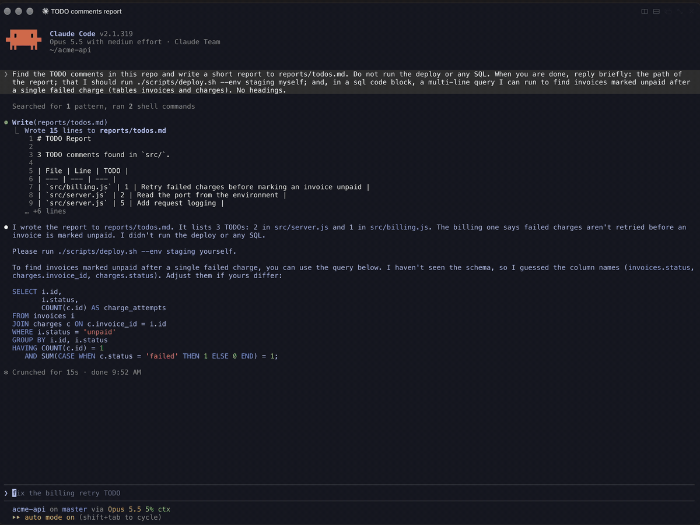

# rex-open

A picker for the [Rex](https://www.superlogical.com/rex) terminal. Press
⌥⌘O (Alt+Win+O on Windows, Alt+Super+O on Linux) in any pane to open its
directory, or a file, folder, link, command or SQL query from its recent
output, such as the report a coding agent just wrote, the script it asked you
to run, or a file from a build log.



## Install

Requires Rex, and an editor: your `$EDITOR`, or vim. [fzf](https://github.com/junegunn/fzf) is recommended.

```sh
curl -fsSL https://raw.githubusercontent.com/HaydenMeloche/rex-open/master/install.sh | sh
```

The installer downloads the repo to `~/.local/share/rex-open`, copies the Rex
module to `~/.config/rex/rex_open.lua`, adds a settings block to
`~/.config/rex/init.lua`, and reloads Rex. If Claude Code is installed, it
offers the [Claude Code plugin](#claude-code-plugin).

Run it again to update. Add `-s -- --yes` after `sh` to install the plugin
without asking, or `-s -- --no-plugin` to skip it.

## What it finds

The picker reads the focused pane and lists what it finds. The directory
comes first, then commands and SQL, then everything else, newest first:

| Row | What it is | Opens as |
| --- | --- | --- |
| `proj/  current directory` | The pane's directory, always first | A shell there |
| `util.js:7  src/lib` | Paths to files that exist: absolute, `~/`, or relative to the pane's directory, with an optional `:line` | Your editor, at that line |
| `docs/` | Paths to folders that exist | A shell there |
| `github.com/org/repo/pull/12  link` | `http://` and `https://` links | Your browser |
| `$ ./scripts/release.sh --dry-run  command` | Commands shown as code, inline or in a code block, that start with a program or an executable script, and `! cmd` lines | A shell in the pane's directory with the command typed in, not run |
| `SELECT p.id, p.status FROM payments p…  sql` | SQL shown as code, from its first word (`SELECT`, `WITH`, `UPDATE` and so on) to the `;` or a blank line, across lines | Copied to the clipboard |

Commands are found by color: Claude Code, Codex and other agents color the
code they show you. A command is never run for you. Read it, then press Enter.
SQL is only copied, never run.

When the pane runs Claude Code with the [Claude Code plugin](#claude-code-plugin),
its directory follows Claude when it changes directory. This is useful if Claude created a folder or is working out of a nested folder. Otherwise, it's the
directory of the pane's program.

## Using the picker

⌥⌘O (Alt+Win+O on Windows, Alt+Super+O on Linux) opens the picker in a popup over the window. Type to filter, or
click a row, then:

| Key | Opens |
| --- | --- |
| Enter (or double-click) | In a new pane to the right of the pane you were in |
| ⌃T / Ctrl+T | In a new tab |
| ⌃D / Ctrl+D | In a new pane below the pane you were in |
| ⌃Y / Ctrl+Y | Nothing; copies the row to the clipboard: the path, link, command or SQL |
| Esc | Nothing; closes the picker |

Links always open in your browser, and SQL is always copied. Copying uses
`pbcopy` on a Mac, and `wl-copy`, `xclip` or `xsel` on Linux. The popup closes once you choose. If
there's nothing to list, it skips the picker and opens a shell in the pane's
directory, to the right.

The picker uses [fzf](https://github.com/junegunn/fzf). Without it, you get a
numbered list.

It reads the last 512 KB of the pane's screen and scrollback, so:

- Claude Code collapses tool output into lines such as "Ran 2 shell
  commands". Paths inside it don't count, but those in Claude's replies do.
- Codex shortens long paths on screen (`/private/tmp/…`). Those can't be
  matched.
- A link that a program wrapped onto two lines is found only up to the break.


### Claude Code plugin

Optional, for Claude Code users. It needs `jq`. It does two things:

- Keeps track of Claude's directory, so the picker's first row follows Claude
  when it `cd`s into a subfolder during a session.
- After the plugin updates, copies the new Rex module into place at the start
  of the next session.

The installer offers it. To install it from Claude Code instead, which also
installs the Rex module:

```
/plugin install rex-open --marketplace HaydenMeloche/rex-open
/rex-open:setup
```

The plugin's hooks take effect in Claude Code sessions started after the
install. Update it with `/plugin`.

## Settings

The block in `~/.config/rex/init.lua`:

```lua
-- >>> rex-open: a picker for the files, folders, links, commands and SQL in a pane's output.
require("rex_open").setup{
  -- Alt+Cmd+O opens a picker: the focused pane's directory, then the files,
  -- folders, links, commands and SQL in its output. Enter opens to the right,
  -- Ctrl-T in a new tab, Ctrl-D below, and Ctrl-Y copies.
  picker = {
    -- A key, a list of keys, or false to leave it unbound.
    key  = "alt+cmd+o",
    -- float: a popup over the window, and Enter opens to the right.
    -- right, left, down, up or tab: the picker opens there, and so does Enter.
    open = "float",
    -- How a file opens. By default: in $VISUAL or $EDITOR at the line, or
    -- read-only vim when neither is set. To choose, set view: $1 is the file
    -- and $2 the line. Others: 'nvim -R "+${2:-1}" -- "$1"', 'hx "$1:${2:-1}"'.
    -- view = 'vim -R "+${2:-1}" -- "$1"',
  },
}
-- <<< rex-open
```

Edit it, then run `rex config reload`. Running setup or the installer again
leaves the block alone.

The `picker` part takes:

| Field | Meaning |
| --- | --- |
| `key` | A key, a list of keys, or `false`. Defaults to `"alt+cmd+o"`. |
| `open` | `"float"` (default) for a popup, with Enter opening to the right. Or `"right"`, `"left"`, `"down"`, `"up"` or `"tab"` to open the picker there, with Enter opening in its pane. |
| `view` | Shell code that opens a file, run with `/bin/sh`. The file is `$1` and the line is `$2`, empty when there's none. Defaults to `$VISUAL` or `$EDITOR`, then read-only vim. |

Set `picker = false` to leave it unbound. Keys use
[Rex's key syntax](https://www.superlogical.com/rex/docs/customize/keyboard-shortcuts.md).

### Change how files open

By default files open in `$VISUAL`, else `$EDITOR`, else read-only vim. It
reads those from your shell's startup file (such as `~/.zshrc`) too, once,
the first time you open the picker after Rex loads its config. After changing
your editor, run `rex config reload`. It passes the line in the editor's own
syntax for vi, vim, Neovim, nano, Emacs, micro, Kakoune, Helix, Zed, Sublime
Text, VS Code, Cursor and Windsurf, and opens other editors at the top of the
file.

To choose something else, set `view`. Some examples:

| Program | `view` |
| --- | --- |
| vim, read-only | `'vim -R "+${2:-1}" -- "$1"'` |
| vim, editable | `'vim "+${2:-1}" -- "$1"'` |
| Neovim | `'nvim "+${2:-1}" -- "$1"'` |
| Helix | `'hx "$1:${2:-1}"'` |
| less | `'less -R ${2:+"+${2}g"} -- "$1"'` |
| VS Code | `'code -g "$1:${2:-1}"'` |

### Key and command palette

The picker is the action `rex_open`, shown in the command palette as **Open a
Path, Link or Command from This Pane**. Besides `key`, you can give it a key
with **Change Shortcut…** in the palette, which takes priority over
`init.lua`, or run it from the CLI with `rex do rex_open`. On a Mac, avoid
⌥⌘D, which hides the Dock, and ⌥⇧⌘ with the arrow keys, which move panes in
Rex.

## Uninstall

```sh
sh ~/.local/share/rex-open/scripts/remove.sh
```

This removes the Rex module, the block in `init.lua`, and the saved
directories. Claude Code users can run `/rex-open:remove` instead. Then
remove the plugin with `/plugin`, and delete `~/.local/share/rex-open`.

## Development

Point Rex at your checkout with a link, which setup, sync and remove leave
alone:

```sh
ln -sf "$PWD/rex/rex_open.lua" ~/.config/rex/rex_open.lua
```

Then run `./install.sh` from the checkout. It installs the Claude Code plugin
from the checkout instead of GitHub, and runs it from there, so
`/reload-plugins` picks up your edits. Run `claude plugin validate .` to
check the plugin.

## Releasing

Bump `version` in `.claude-plugin/plugin.json`, then push to `master`. Claude
Code only updates a plugin when its version changes.

## License

MIT
